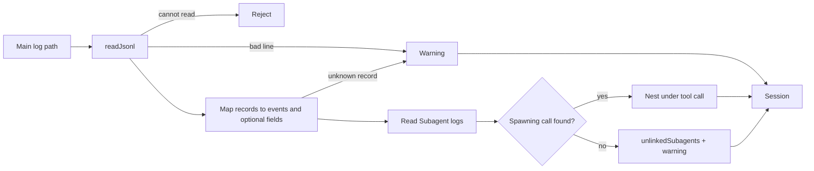

# Session Reader

A Session Reader turns one agent's Session log into one agent-independent `Session` object that the Grader reads. There is one Session Reader per agent; this document covers Claude Code and Antigravity.

## 1. Functional Definition

### 1.1 Responsibilities

| Does | Does not |
| ---- | -------- |
| Read one Session whose path the caller gives | Find Sessions or skip Sessions from before installation (CLI / daemon) |
| Convert the agent's records into the common `Session` shape | Decide which part of a Session concerns which Skill, Subagent or Rule Item (Grader) |
| Nest each Subagent's Session under the tool call that spawned it | Split a Rule File into Rule Items |
| Record which Skills, Subagents and Rule Files the agent offered or loaded, as far as the log shows | Record versions of Skills, Subagents or Rule Files (the Session start hook) |
| Skip bad lines and unknown records, and report them as warnings | Read files outside the agent's own Session log (no `SKILL.md`, no Claude Code `tool-results/`) |

The Session Reader never sends anything over the network. Its output stays on the user's machine.

### 1.2 Files Read

| Agent | Read | Never read |
| ----- | ---- | ---------- |
| Claude Code | `~/.claude/projects/<slug>/<uuid>.jsonl`; `<uuid>/subagents/agent-<id>.jsonl` and `agent-<id>.meta.json` | `<uuid>/tool-results/` |
| Antigravity | `~/.gemini/antigravity/brain/<uuid>/.system_generated/logs/transcript_full.jsonl`; `.system_generated/subagents/<childId>.json`; each child's own `brain/<childId>/.../transcript_full.jsonl` | `transcript.jsonl` (cuts fields at about 4 KB), `logs/chunks/`, `messages/`, `steps/`, `tasks/` |

Large tool outputs that Claude Code stores in `tool-results/` are left out on purpose: the log holds the preview the model saw, and that is what the Grader judges.

### 1.3 Required and Optional Parts

Every agent's log has messages, tool calls and Subagents, so those form the required part. Whether the other information is in the log depends on the agent, so it forms the optional part.

| Optional field | Meaning | Claude Code | Antigravity |
| -------------- | ------- | ----------- | ----------- |
| `skillsOffered` | Skills listed to the model | `skill_listing` attachment | Absent |
| `subagentsOffered` | Subagents listed to the model | `agent_listing_delta` attachment | Absent |
| `ruleFiles` | Rule Files loaded, with full content | `instructions` attachment | Absent |
| `skillInvocations` | Skills used, with who started them | See 1.4 | See 1.4 |
| `interrupts` | The user stopped the agent | `[Request interrupted by user…]` text | Absent |
| `toolDenials` | A tool call was blocked or rejected | `toolDenialKind` on the result record | Absent |
| `compactions` | The context was compacted | `compact_boundary` + compact summary | `CHECKPOINT` record |

Presence rule:

- An **absent** field means the agent does not record this information. The Grader must not read it as "none happened".
- An **empty array** means the agent records it and nothing happened in this Session.
- Presence depends on the agent, never on the file: the Claude Code reader always sets all seven fields, and the Antigravity reader always sets only `skillInvocations` and `compactions`.

### 1.4 Skill Invocations

Each invocation has a `source`: `user` when the person asked for the Skill, `model` when the model chose it, `unknown` when the log does not say.

| Agent | Log shows | `source` |
| ----- | --------- | -------- |
| Claude Code | `Skill` tool call | `model` |
| Claude Code | `Skill` tool call for a Skill the user named in the prompt (`skill_mention` attachment since the last typed prompt) | `user` |
| Claude Code | Typed `/<name>` command followed by the Skill body with no `sourceToolUseID`; the invocation sits at the command record | `user` |
| Antigravity | `read_file` whose path ends in `/skills/<name>/SKILL.md` | `unknown` |
| Antigravity | `run_command` whose first word is a read command (`cat`, `head`, `tail`, `less`, `more`, `bat`, `sed`, `type`, `Get-Content`) with an argument ending in `/skills/<name>/SKILL.md` | `unknown` |
| Antigravity | Either read above, after a typed `/<name>` for the same Skill and before the next typed prompt | `user` |

Not invocations:

- A Skill named in the prompt that the model then does not call.
- Built-in commands such as `/compact` and `/clear`.
- The Skill body that follows a `Skill` tool call (it belongs to that call).
- Skill bodies injected again after compaction (`invoked_skills`) or by a hook (`hook_additional_context`).
- Other files in a Skill folder, such as `references/*.md`.
- `ls`, `grep`, `find`, `rg` or other commands that only mention a `SKILL.md` path.
- A shell command that writes to a `SKILL.md` through a redirect (`cat > .../SKILL.md`).
- An Antigravity `/<name>` with no later read of that Skill.

The path rule `/skills/<name>/SKILL.md` covers every Antigravity Skill location in the official docs (`.agents/skills/`, `.agent/skills/`, `~/.gemini/config/skills/`, `~/.gemini/antigravity/builtin/skills/` and the others). The Antigravity shell and slash-command rules follow the docs; no real log sample exists yet.

### 1.5 Rule Files

- Each loaded Rule File becomes one `ruleFiles` entry with `path`, `kind` (the agent's own label, such as Claude Code `Project` or `AutoMem`), full `content`, `timestamp` and `eventIndex`.
- When Claude Code reloads Rule Files during a Session (`changed: true`, after an edit, `/clear` or compaction), the record holds only the changed files. Each becomes a further entry with its new content; earlier entries stay.
- `AutoMem` (`MEMORY.md`) is kept like any other Rule File. Excluding it from reports is up to the report step, not the Session Reader.
- Rule Files that Claude Code loads from subdirectories during a Session (`nested_memory`) have no real sample yet; they produce an `unknown record type` warning until one exists.

### 1.6 Subagents

| Agent | Link from Subagent Session to the spawning call |
| ----- | ----------------------------------------------- |
| Claude Code | `meta.toolUseId` equals the `id` of an `Agent` tool call in the main log |
| Antigravity | The first `invoke_subagent` result whose output contains `"conversationId": "<childId>"`. `manage_subagents` and `send_message` results also name child ids and are not used. `spawnStepIndex` is not used because siblings can share it |

An Antigravity `subagents/<childId>.json` whose `childId` is not a plain id (letters, digits, `_`, `-`) or names a Session already being read (itself or one of its parents, as in an A → B → A loop) is skipped with a warning, so the reader never leaves the brain folder or loops.

A Subagent Session that cannot be linked (no `meta.json`, no `toolUseId`, for example when a slash command started it, or no matching call) goes into `unlinkedSubagents` with a warning. Only Subagents spawned by the main agent are linked; a Subagent spawned by another Subagent lands in `unlinkedSubagents`.

### 1.7 Warnings and Errors

| Case | Result |
| ---- | ------ |
| Main log cannot be read (missing, no permission) | The function rejects. The message names the path and error code only. The caller skips the Session |
| Line is not valid JSON, or not a JSON object | Line skipped, warning |
| Empty or whitespace-only line | Line skipped, no warning |
| Unknown record type, `system` subtype or `attachment` type | Record skipped, warning |
| Known record with an unexpected shape (e.g. assistant content not an array) | Record skipped, warning |
| Tool result with no matching tool call | Result dropped, warning |
| Compact summary with no compaction before it | Summary dropped, warning |
| Subagent log missing or unreadable | Warning in the parent Session |
| Subagent cannot be linked | Added to `unlinkedSubagents`, warning |
| Record types known to carry nothing for the Grader | Skipped, no warning (see 2.3) |

A warning holds a 1-based line number (absent for file-level warnings) and a short fixed reason, at most with the record type name. It never holds Session content.

## 2. Internal Flow



### 2.1 Claude Code

1. Read the main log with `readJsonl`. Take `cwd`, `gitBranch` and `version` from the first record that has them.
2. Walk the records in order:
   - A typed `user` record becomes a `UserEvent` with `meta: false`; an `isMeta` record (Skill body, reminder, Subagent message) becomes `meta: true`.
   - `assistant` records are grouped by `message.id`. Claude Code writes one record per content block, each repeating `usage`, and the records of one response are not always next to each other (parallel tool calls put tool results between them). The first record creates the `AssistantEvent`; later ones add their text and thinking, and their `tool_use` blocks become `ToolCallEvent`s at their own position. `usage` is taken once.
   - A `tool_result` block becomes the `result` of the tool call with the same id. A `toolDenialKind` on that record adds a `toolDenials` entry with the kind as recorded.
   - Interrupt texts, `compact_boundary`, compact summaries and the listing and `instructions` attachments fill the optional fields (1.3–1.5).
3. Work out each Skill invocation's source (1.4).
4. For each file in `<uuid>/subagents/`, read it with the same function and link it (1.6).

### 2.2 Antigravity

1. Read `transcript_full.jsonl` with `readJsonl`.
2. Walk the records in order:
   - `USER_INPUT` becomes a `UserEvent` with `meta: false`; its text is the part inside `<USER_REQUEST>` when present, trimmed (`<ADDITIONAL_METADATA>` and `<USER_SETTINGS_CHANGE>` are dropped).
   - `SYSTEM_MESSAGE` becomes a `UserEvent` with `meta: true`.
   - `PLANNER_RESPONSE` becomes an `AssistantEvent`; each of its `tool_calls` becomes a `ToolCallEvent` with id `<line>:<n>`, because `step_index` can repeat.
   - Each `GENERIC` record is the result of the oldest pending tool call of the preceding `PLANNER_RESPONSE` (Antigravity writes results in call order). `status: "ERROR"` sets `isError`.
   - `CHECKPOINT` adds a `compactions` entry.
3. Match Skill reads and slash commands (1.4).
4. For each `subagents/<childId>.json`, read the child's brain dir with the same function and link it (1.6).

### 2.3 Records Skipped Without a Warning

| Agent | Skipped |
| ----- | ------- |
| Claude Code, top-level types | `api-request`, `api-request-blob`, `api-request-shape`, `queue-operation`, `last-prompt`, `session-owner`, `atis-latch`, `ai-title`, `mode`, `permission-mode`, `file-history-snapshot`, `file-history-delta`, `cost-state`, `tools-used`, `pr-link`, `frame-link`, `artifact-autoreact-ledger`, `artifact-comment-monitor` |
| Claude Code, `system` subtypes | `informational`, `turn_duration`, `away_summary`, `local_command` |
| Claude Code, `attachment` types | `deferred_tools_record`, `deferred_tools_delta`, `environment`, `queued_command`, `prompt_snapshot`, `edited_text_file`, `date`, `model`, `credential_org`, `session_context`, `remote_session_change`, `auto_mode`, `silent_turn_reminder`, `file`, `command_permissions`, `mcp_instructions_delta`, `total_tokens_reminder`, `compact_file_reference`, `thinking_drop`, `invoked_skills`, `hook_additional_context`, `hook_success`, `task_status`, `directory`, `plan_mode_exit`, `at_mention_reference`, `skill_mention` (used only to decide the source in 1.4) |
| Claude Code, record fields | `toolUseResult` (a structured copy; the `tool_result` block is what the model saw), `digests`, `requestId`, `isSidechain`, `interruptedByShutdown` |
| Antigravity, record fields | `status` other than `ERROR`, `error` (its text is already in `content`), `media`, `source` |

`session_context` holds the user's account details and is never copied.

## 3. External Interface

```ts
// path = ~/.claude/projects/<slug>/<uuid>.jsonl
function readClaudeCodeSession(path: string): Promise<Session>;

// dir = ~/.gemini/antigravity/brain/<uuid>
function readAntigravitySession(dir: string): Promise<Session>;

interface Session {
  agent: 'claude-code' | 'antigravity';
  sessionId: string; // Claude Code: file stem (`<uuid>`, `agent-<id>` for a Subagent). Antigravity: brain dir name
  metadata: SessionMetadata;
  events: SessionEvent[]; // in log order
  unlinkedSubagents: SubagentSession[];
  warnings: Warning[]; // this Session's own log only

  // Optional part: absent = not recorded by this agent; [] = recorded, none happened
  skillsOffered?: OfferedItem[];
  subagentsOffered?: OfferedItem[];
  ruleFiles?: RuleFileLoad[];
  skillInvocations?: SkillInvocation[];
  interrupts?: Interrupt[];
  toolDenials?: ToolDenial[];
  compactions?: Compaction[];
}

interface SessionMetadata {
  cwd?: string;
  gitBranch?: string;
  agentVersion?: string;
}

type SessionEvent = UserEvent | AssistantEvent | ToolCallEvent;

interface UserEvent {
  type: 'user';
  timestamp: string;
  text: string;
  meta: boolean; // true = injected by the agent, false = typed by the person
}

interface AssistantEvent {
  type: 'assistant'; // one per model response
  timestamp: string;
  text: string; // '' when the response only made tool calls
  thinking?: string;
  model?: string;
  usage?: TokenUsage;
}

interface TokenUsage {
  input: number;
  output: number;
  cacheRead?: number;
  cacheWrite?: number;
}

interface ToolCallEvent {
  type: 'tool_call';
  timestamp: string;
  id: string; // Claude Code: tool_use id. Antigravity: `<line>:<n>`
  name: string;
  input: unknown; // tool input as recorded
  result?: ToolResult; // absent = no result in the log
  subagent?: SubagentSession; // set on the call that spawned it
}

interface ToolResult {
  timestamp: string;
  output: string; // text blocks joined with '\n'; non-text blocks become '[image]'
  isError: boolean;
}

interface SubagentSession {
  subagentType?: string;
  description?: string;
  session: Session;
}

interface OfferedItem {
  name: string;
  description?: string;
}

interface RuleFileLoad {
  path: string;
  kind?: string; // the agent's label, e.g. 'Project', 'AutoMem'
  content: string;
  timestamp: string;
  eventIndex: number; // number of events before it
}

interface SkillInvocation {
  name: string;
  source: 'user' | 'model' | 'unknown';
  timestamp: string;
  eventIndex: number;
  toolCallId?: string;
}

interface Interrupt {
  timestamp: string;
  eventIndex: number;
}

interface ToolDenial {
  toolCallId: string;
  kind: string; // as recorded, e.g. 'user-rejected', 'interrupted', 'permission-rule'
  timestamp: string;
}

interface Compaction {
  timestamp: string;
  eventIndex: number;
  trigger?: string; // Claude Code: 'manual' | 'auto'
  summary?: string;
}

interface Warning {
  line?: number; // absent for file-level warnings
  reason: string;
}
```

- Both functions reject only when the main log cannot be read (1.7). Every other problem is a warning.
- Token counts are copied as the agent records them. Whether Antigravity's `input_tokens` includes cached tokens is not documented.
- `index.ts` exports the two functions and the types. `readJsonl` is internal.

## 4. Class Architecture

### 4.1 Modules

| Module | Responsibility |
| ------ | -------------- |
| `session.ts` | The `Session` types (types only) |
| `jsonl.ts` | `readJsonl(path)`: splits lines, parses JSON, returns `{ line, record }` items and warnings for bad lines; rejects when the file cannot be read. Shared by both readers. Internal |
| `claude-code.ts` | `readClaudeCodeSession()` |
| `antigravity.ts` | `readAntigravitySession()` |
| `index.ts` | Exports both functions and the types |

The two readers share nothing except `readJsonl`: no base class, no registry, no common reader interface. Another agent's Session Reader is another plain function next to these.

### 4.2 Directory Layout

```text
packages/session-reader/
├── package.json        # @skill-scope/session-reader, no runtime dependencies
├── tsconfig.json
├── src/
│   ├── session.ts
│   ├── jsonl.ts
│   ├── jsonl.test.ts
│   ├── claude-code.ts
│   ├── claude-code.test.ts
│   ├── antigravity.ts
│   ├── antigravity.test.ts
│   └── index.ts
└── fixtures/
    ├── claude-code/projects/-home-user-example/
    │   ├── <main>.jsonl            # full Session with Subagents
    │   ├── <main>/subagents/       # linked, unlinked and missing-meta Subagents
    │   ├── <main>/tool-results/    # decoy: must never be read
    │   ├── <minimal>.jsonl         # optional fields present but empty
    │   └── <bad>.jsonl             # malformed lines and filtered-out records
    └── antigravity/brain/
        ├── <parent>/.system_generated/
        │   ├── logs/transcript_full.jsonl
        │   ├── logs/transcript.jsonl   # decoy: must never be read
        │   └── subagents/              # linked child and missing child
        ├── <child>/
        └── <bad>/                      # malformed lines
```

## 5. Test Plan

| Type | Coverage | Location |
| ---- | -------- | -------- |
| Unit | `readJsonl`: 1-based line numbers with blank lines counted, CRLF, trailing newline, whitespace-only lines skipped silently, invalid JSON and non-object lines become warnings, missing file rejects | `packages/session-reader/src/jsonl.test.ts` |
| Unit | Claude Code: required fields and event order; one `AssistantEvent` and usage taken once per `message.id`, also when tool results sit between its records; tool results and denials matched by id; interrupts; compaction with summary; Rule File loads incl. a changed Rule File reloaded mid-Session; offered Skills and Subagents incl. removals; every Skill invocation source and every non-invocation in 1.4; Subagent linking and the unlinked cases; every record in 2.3 skipped without a warning; optional fields are empty arrays, not absent, in a minimal Session; each malformed case gives one warning with the right line and the rest still parses | `packages/session-reader/src/claude-code.test.ts` |
| Unit | Antigravity: `transcript_full.jsonl` is read, not `transcript.jsonl`; `USER_REQUEST` extraction; tool call ids unique when `step_index` repeats; positional results incl. `ERROR` and `RUNNING`; `CHECKPOINT` compaction; Skill reads by `read_file`, `cat` and `Get-Content`, slash command as `user`, and the non-invocations (`references/` files, `ls`, `grep`, `/<name>` with no read); Subagent linked only through `invoke_subagent`; missing child; optional fields other than `skillInvocations` and `compactions` absent | `packages/session-reader/src/antigravity.test.ts` |
| Unit | Privacy, both readers: warnings and rejection messages hold no Session text; decoy markers never appear in the output; `session_context` is not copied | both reader test files |

Fixtures are trimmed excerpts of real local Sessions. Before they are committed, free text is replaced with neutral placeholders and paths, user names, emails, branch names and ids with fake values; a grep for real paths, email addresses and token prefixes must come back empty. Records with no real sample (Antigravity shell reads and slash commands, some edge cases) are hand-made, and their fixture folder says so in a one-line `README`.
